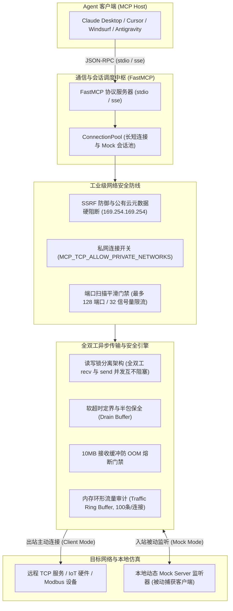

# TCP 协议代理与联调服务

通用 **TCP 协议代理与自动化测试** 模型上下文协议 (Model Context Protocol, MCP) 官方服务端，基于 **Python 3.10+**、**FastMCP** 与 **asyncio** 现代化异步架构构建。

赋能大语言模型（LLM）与智能体与任意 TCP 目标服务、IoT 工业硬件（如 Modbus、PLC 设备）及私有二进制协议进行全双工安全收发、自动化交互联调、端口平滑探针扫描及本地仿真 Mock 测试。

---

## 1. 核心架构与设计特性



### 1.1 双向通信全能与本地 Mock 仿真
- **主动出站客户端**：支持针对目标 IP 与端口建立一次性短连接探针（`tcp_send_once`）或长期保持的长连接会话（`tcp_connect`）；
- **被动入站 Mock 仿真**：支持由大模型动态拉起本地端口监听器（`tcp_start_server`），捕获外部设备连入、自动分配会话 ID、广播下发指令并模拟报文应答。

### 1.2 原生全双工并发与读写锁分离
- 采用读写锁分离架构，在长连接维持长轮询接收（`tcp_recv_text` / `tcp_recv_hex`）挂起等待时，**绝不阻塞**并行的上行指令下发（`tcp_send_text` / `tcp_send_hex`），完美支持双工信令交互。

### 1.3 原子定界、软超时与半包保全 (Drain Buffer)
- 独创软超时机制（Soft Timeout）：当指定报文定界符（如 `\r\n`）在超时时间内尚未到达时，不破坏底层 TCP 字节流，无损保全已读取的半包缓冲（Drain Buffer）静默等待后续报文拼接；
- 内置 10MB 单连接接收缓冲区上限，防止异常泛洪攻击导致内存 OOM 熔断。

### 1.4 探针并发平滑门禁
- 批量端口扫描（`tcp_port_scan`）实施严格防风暴限额：单次最多允许扫描 128 个端口，底层基于 32 信号量协程池平滑并发，杜绝宿主机套接字句柄耗尽崩溃。

### 1.5 内存环形流量审计与 MCP 资源订阅
- 每个活跃连接独享 100 条记录的环形队列（Traffic Ring Buffer），毫秒级记录时间戳、收发传输方向及 Hex/文本快照，零磁盘污染；
- 开放标准 MCP Resource 挂载能力，客户端可直接订阅与读取链路流量快照。

---

## 2. 13 个核心工具契约字典 (Tools Contract)

服务精炼封装了 13 个原子工具，涵盖网络探针、会话管理、精准收发、Mock 仿真与调试审计：

| 分类 | 工具名称 | 参数契约 | 功能描述与安全约束 |
| :--- | :--- | :--- | :--- |
| **网络探针** | `tcp_ping_port` | `(host: str, port: int, timeout_seconds=3.0)` | 测试指定主机端口的 TCP SYN 握手时延（毫秒）与可达性 |
| | `tcp_port_scan` | `(host: str, ports: list[int], timeout_seconds=2.0)` | 并发探测目标主机端口开放状态（上限 128 端口，32 信号量平滑限流） |
| | `tcp_send_once` | `(host: str, port: int, data: str, is_hex=False, timeout_seconds=5.0)` | 一次性短连接发收探针（自动完成连接、发送、读取与优雅关闭） |
| **会话管理** | `tcp_connect` | `(host: str, port: int, timeout_seconds=10.0)` | 建立长连接并加入会话池，返回唯一 `conn_id` |
| | `tcp_disconnect` | `(conn_id: str)` | 安全断开指定长连接并穿透式释放套接字 |
| | `tcp_list_connections` | `(server_id: str = None)` | 列出活跃连接（支持 `server_id` 拓扑过滤，展示入站/出站标识与待读缓冲） |
| **精准收发** | `tcp_send_text` | `(conn_id: str, data: str, append_crlf=False)` | 发送 UTF-8 文本数据（可选追加 `\r\n`，全双工独立写锁保护） |
| | `tcp_send_hex` | `(conn_id: str, hex_data: str)` | 发送原始十六进制字节序列（Hex Payload） |
| | `tcp_recv_text` | `(conn_id: str, delimiter=None, max_bytes=65536, timeout_seconds=5.0)` | 接收文本，支持定界符截断（定界符未达保全半包）、软超时返回与防 OOM 熔断 |
| | `tcp_recv_hex` | `(conn_id: str, max_bytes=65536, timeout_seconds=5.0)` | 接收二进制字节流并格式化为 Hex 视图，支持最大字节数限制与防 OOM 熔断 |
| **Mock 服务** | `tcp_start_server` | `(port: int, host="127.0.0.1")` | 启动本地 TCP 服务监听器，外部连入客户端自动分配 `conn_id` 入池 |
| | `tcp_broadcast` | `(server_id: str, data: str, is_hex=False)` | 向指定 Mock Server 连入的所有活跃客户端同时群发数据 |
| | `tcp_stop_server` | `(server_id: str)` | 停止服务监听并释放端口绑定，级联断开所有附属客户端 |
| **调试审计** | `tcp_dump_traffic` | `(conn_id: str, limit=50)` | 回溯指定连接最近的收发报文记录（含时间戳与方向快照） |

---

## 3. 标准 MCP 资源契约 (Resources Contract)

服务端提供标准 MCP 资源订阅能力，便于 Agent 挂载并实时回溯链路流量快照：

| 资源 URI 模式 | MIME 类型 | 说明 |
| :--- | :--- | :--- |
| `tcp://connection/{conn_id}/traffic` | `application/json` | 读取或订阅指定长连接的 Traffic Ring Buffer 流量审计数据（最多 100 条双工收发记录） |

---

## 4. 安装与运行方式

### 4.1 方式 1：使用 `uvx` 免安装直接运行（强烈推荐）

无需手动安装 Python 虚拟环境，客户端直接通过 `uvx` 调起：

```bash
uvx atengk-mcp-server-tcp
```

### 4.2 方式 2：使用 Docker 容器化运行

服务端同时发布多架构容器镜像至 GitHub Packages (`ghcr.io`)：

```bash
docker run -i --rm \
  -e MCP_TCP_MAX_CONNECTIONS=20 \
  -e MCP_TCP_ALLOW_PRIVATE_NETWORKS=true \
  ghcr.io/atengk/mcp-server-tcp:latest
```

---

## 5. 环境变量与配置参数

服务端支持通过系统环境变量进行无代码侵入式参数调优：

| 环境变量名称 | 默认值 | 作用说明 |
| :--- | :--- | :--- |
| `MCP_TCP_MAX_CONNECTIONS` | `10` | 连接池最大允许的并发连接数配额上限 |
| `MCP_TCP_IDLE_TIMEOUT_SECONDS` | `300.0` | 连接空闲自愈阈值（秒），超过此时间未活动的连接将被后台协程自动回收 |
| `MCP_TCP_ALLOW_PRIVATE_NETWORKS` | `true` | 是否允许连接本地回环（`127.0.0.1`）与私网网段（RFC 1918）。企业安全受限环境可置为 `false` 一键拦截 |

> 🔒 **强制安全防线**：无论如何配置，公有云敏感元数据端点（AWS/GCP/Azure `169.254.169.254`、阿里云 `100.100.100.200` 等）均被绝对物理阻断，保障宿主网络免受 SSRF 渗透。

---

## 6. 客户端接入配置模版

### 6.1 Claude Desktop 配置

在 `claude_desktop_config.json` 中配置：

```json
{
  "mcpServers": {
    "tcp": {
      "command": "uvx",
      "args": ["atengk-mcp-server-tcp"],
      "env": {
        "MCP_TCP_MAX_CONNECTIONS": "10",
        "MCP_TCP_ALLOW_PRIVATE_NETWORKS": "true"
      }
    }
  }
}
```

### 6.2 Cursor 配置

在项目根目录下 `.cursor/mcp.json` 中配置：

```json
{
  "mcpServers": {
    "tcp": {
      "command": "uvx",
      "args": ["atengk-mcp-server-tcp"]
    }
  }
}
```

---

## 7. 典型使用场景与 Prompt 范式

### 场景 1：主动探查服务连通性与单次发收
> “帮我探测 `192.168.1.100` 的 6379 端口是否连通并测试握手时延；如果正常，发送单次 HTTP 探测 `GET /health HTTP/1.1\r\nHost: localhost\r\n\r\n` 查看回包内容。”  
> *👉 AI 将自动调度：`tcp_ping_port` ➔ `tcp_send_once`*

### 场景 2：IoT 设备与 Modbus 二进制协议调试
> “连接目标 PLC 工业设备 `192.168.1.200:502`，发送 Modbus 读取保持寄存器指令十六进制报文 `01 03 00 00 00 02 C4 0B`，并将返回的 Hex 字节流转换为工程物理量进行分析。”  
> *👉 AI 将自动调度：`tcp_connect` ➔ `tcp_send_hex` ➔ `tcp_recv_hex` ➔ 结合领域知识解码*

### 场景 3：端口扫描与连通性排障
> “请排查目标服务器 `10.0.0.12` 的常用服务端口 `[22, 80, 443, 3306, 6379, 8080, 9092]` 开放状态，并列出可连通的端口列表。”  
> *👉 AI 将自动调度：`tcp_port_scan` 平滑扫描*

### 场景 4：本地 Mock Server 仿真与客户端交互
> “在本地启动一个 TCP Mock 服务端监听 `9999` 端口，查看是否有测试客户端连入；一旦收到外部连入，调出流量审计回溯报文内容并向其回复 `ACK\r\n`。”  
> *👉 AI 将自动调度：`tcp_start_server` ➔ `tcp_list_connections` ➔ `tcp_recv_text` / `tcp_send_text` ➔ `tcp_dump_traffic`*
