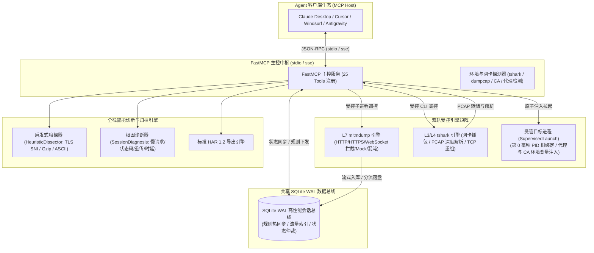

# 全栈网络流量抓包与诊断服务

工业级**全栈网络流量巡检、抓包审计与链路诊断**模型上下文协议 (Model Context Protocol, MCP) 官方服务端，基于 **Python 3.11+**、**FastMCP**、**mitmproxy**、**tshark (Wireshark)** 与 **SQLite WAL** 现代化主从解耦架构构建。

为 AI Agent 与大模型赋予完整的网络流量深度观测、进程第 0 毫秒受管注入、参数变异重放、WebSocket 帧级审计、TCP 会话流重组、启发式嗅探、混沌故障注入与根因诊断全闭环能力。

---

## 1. 核心架构与设计特性



### 1.1 主控与受控子进程解耦架构
- 采用 FastMCP 主控进程与抓包引擎解耦架构，通过高性能 **SQLite WAL 共享数据总线** 进行控制指令与流量数据的异步交互；
- 主控进程免受抓包高频 I/O 阻塞，子进程异常崩溃自动隔离与安全自愈。

### 1.2 应用层 (L7) 流量拦截与变异重放 (Replay & Diff)
- 基于 `mitmdump` 引擎捕获 HTTP/HTTPS 流量，支持按 URL、状态码、域名模糊过滤；
- 支持 `compact=True` 紧凑模式，大幅剥离冗余标头，节约 75% Agent 上下文 Token；
- 提供 `replay_http_request` 工具，支持动态变异请求 Headers 或 Body 进行对比重放并输出 Diff。

### 1.3 网络混沌故障注入与时延仿真 (ChaosInjection)
- 支持通过 `add_intercept_rule` 注入前置毫秒级网络延迟（`delay_ms`）、模拟物理连接异常瞬断（`action="abort"`）及原子限次生效机制（`max_hits`），全自动检验客户端容错与降级链路。

### 1.4 受管进程第 0 毫秒双轨捕获 (SupervisedLaunch)
- 提供 `launch_and_inspect_process` 工具，在拉起 CLI 脚本或测试微服务瞬间原子注入代理网络参数与非系统运行时 CA 环境变量，第 0 毫秒绑定 PID 树时空切片与双轨抓包，彻底根除启动期漏包与多实例端口混淆。

### 1.5 WebSocket 帧级全链路审计
- 捕获双向 WebSocket 消息帧，自动抑制 PING/PONG 心跳干扰，超大载荷（>256KB）分流落盘；对齐 Chrome DevTools 规范导出 `_webSocketMessages` HAR 1.2 归档。

### 1.6 传输层 (L3/L4) 原始抓包、TCP 流重组与启发式嗅探
- 集成 Wireshark `tshark` 引擎，支持多网卡自动协同捕获（`MultiInterfaceCapture`）与双重安全熔断（默认 2000 包 / 60 秒）；
- 提供 `follow_tcp_stream`，按客户端/服务端交互时序回合（Turns）对齐 Wireshark 高保真重组；内置启发式嗅探器（`HeuristicDissector`），自动提取 TLS SNI 域名、识别 HTTP/WS 帧、解压 Gzip 并提炼连续 ASCII 明文。

### 1.7 智能代理权属感知与 CA 免提权静默直装
- 支持抓包启停自动接管 Windows 全局代理并在退出时安全自愈（带权属校验，绝不误关第三方代理软件）；
- Windows 平台支持当前用户受信任根证书库免 UAC 提权一键安装（`trust_ca_certificate`）。

---

## 2. 25 个核心工具契约字典 (Tools Contract)

| 业务分组 | 工具名称 | 参数契约 | 功能描述与安全约束 |
| :--- | :--- | :--- | :--- |
| **L7 抓包控制** | `start_http_capture` | `(port=8080, host="127.0.0.1", auto_set_system_proxy=False)` | 启动 L7 代理抓包服务并可选自动接管系统全局代理 |
| | `stop_http_capture` | `(restore_system_proxy=True, auto_export_har=True)` | 停止 L7 抓包，复位系统代理并自动无损导出 HAR 归档 |
| | `get_capture_status` | `()` | 查看当前 HTTP 抓包服务运行状态、监听端口与已捕获流统计 |
| **L7 检索与重放** | `list_http_flows` | `(limit=20, offset=0, query=None, status_code=None, compact=False)` | 分页检索已捕获的 HTTP 会话流，支持 compact 极简节约 Token 模式 |
| | `get_http_flow_detail`| `(flow_id: str, max_body_chars=2048)` | 获取指定 HTTP 流全息详情（含请求/响应头、Body 预览与耗时） |
| | `replay_http_request` | `(flow_id: str, override_headers=None, override_body=None)` | 变异重放历史请求，返回新响应并对比与原响应的差异 |
| **规则与混沌** | `add_intercept_rule` | `(url_pattern: str, action="mock", mock_status=200, delay_ms=0, max_hits=None)` | 添加请求拦截规则（支持 Mock 响应、毫秒时延注入与断网仿真 abort） |
| | `list_intercept_rules`| `()` | 列出当前所有已注册的活跃拦截与混沌注入规则及命中计数 |
| | `clear_intercept_rules`| `()` | 清空全部拦截与混沌注入规则并恢复实时透传 |
| **WebSocket** | `list_websocket_messages` | `(flow_id: str, limit=50, filter_heartbeats=True)` | 列出指定 WebSocket 流的双向消息帧，默认自动过滤心跳干扰 |
| | `get_websocket_message_detail` | `(message_id: str, max_payload_chars=4096)` | 查看指定 WebSocket 消息帧的完整载荷与元数据详情 |
| **L3/L4 网卡与 PCAP** | `list_network_interfaces` | `()` | 枚举本机可用抓包网卡（含友好别名如 WLAN/以太网与 loopback 标识） |
| | `start_pcap_capture` | `(interface="auto", bpf_filter=None, max_packets=2000, duration_seconds=60)` | 在指定网卡启动底层 PCAP 抓包（双重安全熔断防护） |
| | `stop_pcap_capture` | `()` | 手动提前停止底层 PCAP 抓包并落盘捕获文件 |
| | `analyze_pcap_file` | `(pcap_path: str, limit=50)` | 离线解析 PCAP 抓包文件，输出数据包统计、协议分布与指标 |
| **会话流重组与嗅探** | `list_tcp_streams` | `(pcap_path: str)` | 提取 PCAP 文件中的全部唯一 TCP 会话流清单与端点画像 |
| | `follow_tcp_stream` | `(pcap_path: str, stream_id: int, format="turns")` | 跟踪 TCP 流重组，按交互回合（Turns）还原并执行启发式协议嗅探 |
| **智能诊断与分析** | `analyze_http_traffic` | `(limit=100)` | 宏观统计当前会话流量：状态码分布、高频端点、慢请求 Top 5 |
| | `diagnose_network_session` | `(flow_id=None)` | 全栈 SessionDiagnosis 根因诊断，识别双轨代理重定向与网络拥塞 |
| **系统代理与证书** | `trust_ca_certificate` | `(system_wide=False)` | 一键安装 mitmproxy CA 证书至当前用户受信任根证书库（免 UAC 提权） |
| | `get_ca_certificate` | `()` | 获取当前 CA 证书路径、PEM 文本内容及主流编程语言环境配置指南 |
| | `toggle_system_proxy` | `(enable: bool, host="127.0.0.1", port=8080)` | 手动切换系统全局代理开关（带权属自愈检测） |
| | `get_system_proxy_status` | `()` | 查看当前操作系统代理配置、当前代理服务器与激活状态 |
| **受管进程与归档** | `export_http_session` | `(output_path: str, format="har")` | 导出当前抓包会话至标准 HAR 1.2 归档文件 |
| | `launch_and_inspect_process` | `(command: str, inject_proxy=True, capture_pcap=True, wait_for_exit=True)` | 受管拉起目标进程，第 0 毫秒原子注入网络参数并展开双轨抓包 |

---

## 3. 安装与运行方式

### 3.1 方式 1：使用 `uvx` 免安装直接运行（强烈推荐）

```bash
uvx atengk-mcp-server-traffic-inspector
```

### 3.2 依赖前提与环境自检

- **Python 运行时**：Python 3.11+；
- **底层抓包可选依赖**：若需使用 L3/L4 原始网卡抓包与 PCAP 分析，宿主机需安装 Wireshark 套件中的 `tshark` 并将其加入系统 `PATH`（若仅调试 L7 HTTP/HTTPS/WebSocket 则无需安装 `tshark`）。

---

## 4. 客户端接入配置模版

### 4.1 Claude Desktop 配置

在 `claude_desktop_config.json` 中配置：

```json
{
  "mcpServers": {
    "traffic-inspector": {
      "command": "uvx",
      "args": ["atengk-mcp-server-traffic-inspector"]
    }
  }
}
```

### 4.2 Cursor 配置

在项目根目录下 `.cursor/mcp.json` 中配置：

```json
{
  "mcpServers": {
    "traffic-inspector": {
      "command": "uvx",
      "args": ["atengk-mcp-server-traffic-inspector"]
    }
  }
}
```

---

## 5. 典型使用场景与 Prompt 范式

### 场景 1：HTTP 慢接口抓包与根因排障
> “启动 HTTP 代理抓包监听 8080 端口，并免提权导入 CA 根证书。稍后我会调用业务接口，请帮我列出响应超过 1 秒或 5xx 的请求并给出根因诊断。”  
> *👉 AI 将自动调度：`trust_ca_certificate` ➔ `start_http_capture` ➔ `list_http_flows` ➔ `diagnose_network_session`*

### 场景 2：混沌延迟注入与降级演练 (ChaosInjection)
> “对匹配 `*/v1/order/checkout*` 的接口添加拦截规则，注入 800ms 网络延迟并模拟物理连接切断（`action="abort"`），仅生效 2 次（`max_hits=2`）。随后协助我发起重试调用，验证客户端降级与自愈能力。”  
> *👉 AI 将自动调度：`add_intercept_rule` ➔ `list_intercept_rules` ➔ `clear_intercept_rules`*

### 场景 3：受管脚本拉起与第 0 毫秒双轨抓包 (SupervisedLaunch)
> “使用受管模式拉起我的测试脚本 `python test_suite.py`，自动注入代理与 CA 环境变量，同步开启底层 PCAP 抓包并在脚本运行完毕后汇总网络异常。”  
> *👉 AI 将自动调度：`launch_and_inspect_process` ➔ `analyze_pcap_file`*

### 场景 4：PCAP 会话流重组与启发式协议嗅探
> “分析本地抓包文件 `traffic.pcap`，列出所有 TCP 会话流；对包含未知二进制通信的第 0 号流执行 Follow TCP Stream 回合重组，并利用启发式嗅探提炼 TLS SNI 域名与可读 ASCII 字符串。”  
> *👉 AI 将自动调度：`list_tcp_streams` ➔ `follow_tcp_stream(stream_id=0)`*
