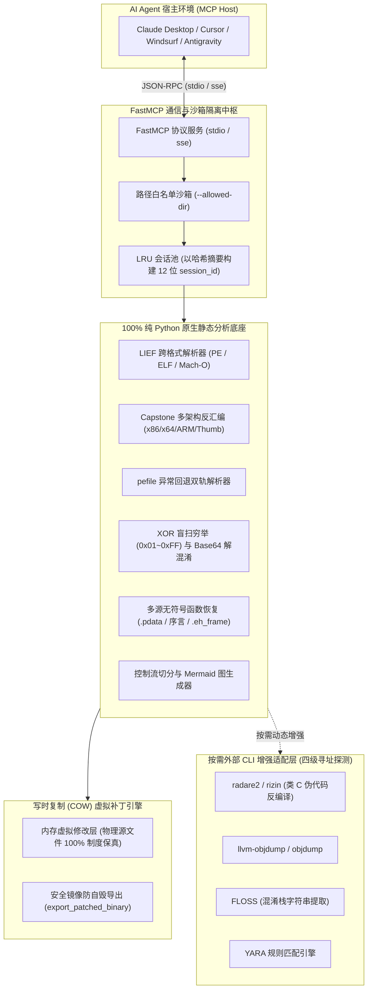

# 二进制逆向分析与数字取证服务

专为 AI Agent 与大语言模型打造的跨平台**下一代二进制静态逆向分析、跨样本比对与纵深数字取证 (DFIR)** 模型上下文协议 (Model Context Protocol, MCP) 官方服务端，基于 **Python 3.11+** 与 **FastMCP** 现代化架构构建。

采用**“纯 Python 静态分析内核（`lief` + `capstone` + `pefile`）+ 按需外部 CLI 增强适配层（`radare2` / `objdump` / `floss` / `yara`）”**混合分层架构：无需预装重型商业逆向软件，开箱即可对 **PE（`.exe`/`.dll`/`.sys`）、ELF（Linux/Android `.so`）、Mach-O（macOS/iOS，含 Fat Binary 多架构切片）** 进行静态全景画像、跨样本二阶结构化差异比对、函数控制流图（CFG）抽取、写时复制（COW）虚拟打补丁、单字节 XOR 反混淆及 .NET CLR 托管程序自动分诊。

---

## 1. 核心架构与设计特性



### 1.1 纯 Python 核心底座与 PE 双轨解析防御
- 基于 `lief`、`capstone` 与 `pefile` 构建全纯 Python 静态解析底座，无需预装任何 C/C++ 动态链接库；
- 针对非标或加壳的 PE32/PE32+ 样本具备 `pefile` 双轨回退解析防御，原生驱动 21 个核心分析工具。

### 1.2 跨会话二阶结构化差异画像 (SSDEEP Binary Diff)
- 提供 `diff_sessions` 一键比对两组样本的 SSDEEP 模糊哈希（0~100 相似度得分）、节区尺寸与香农熵差异（`entropy_delta`，高亮异常高熵加壳节区）、高危导入导出 API 变动集合并自动推导重定位偏移。

### 1.3 写时复制（COW）虚拟打补丁与安全物理导出
- 在分析会话写时复制内存层应用十六进制内存补丁，物理源文件 100% 只读保真，补丁即时驱动反汇编与控制流重绘；
- 提供 `export_patched_binary` 将叠加补丁后的镜像安全落盘，强校验拦截同文件覆写自毁，在类 Unix 平台自动继承源文件执行权限位。

### 1.4 单字节 XOR 穷举盲扫与 Base64 反混淆
- 内置单字节异或（0x01~0xFF）全穷举解密、指定密钥解密与标准 Base64 反混淆解码，无 key 盲扫结合正则精准捕获隐藏 IOC 明文。

### 1.5 多源无符号内部函数恢复体系
- 针对 64 位 PE 解析 `.pdata` 运行时函数表恢复 `sub_<va>`；针对 32 位 PE 扫描标准栈帧序言（`55 8b ec`/`55 89 e5`）；针对 Linux ELF 解析 `.eh_frame` DWARF 展开表恢复非叶函数。

### 1.6 ARM Thumb 模式自适应对齐与反汇编切换
- 自动识别 ARM 奇数目标地址，2 字节对齐并自适应切换 Capstone Thumb 模式，支持显式 `thumb=True` 强制控制，彻底解决 ARM32 共享库反汇编乱码。

### 1.7 .NET CLR 托管程序自动分诊与魔数嗅探 (Format Sniffer)
- 自动探测 PE 数据目录 `IMAGE_DIRECTORY_ENTRY_COM_DESCRIPTOR` 并解析 `BSJB` 提取目标运行时版本（如 `v4.0.30319`），为 Agent 注入专用 CIL 反编译引导（ILSpy / dnSpy）；
- 针对 SWF、DEX、WASM、HAR、PCAP 等非原生二进制格式自动通过特征魔数识别并返回结构化工具重定向建议。

### 1.8 控制流图 (CFG) 与紧凑 Mermaid 可视化
- 自动切分单入口单出口基本块（`BasicBlock`），计算条件跳转、循环回跳边与圈复杂度，直接输出紧凑规范的 Mermaid `flowchart TD` 控制流文本供 Agent 直接阅读。

---

## 2. 23 个正交 MCP Tools 矩阵

| 业务分组 | Tool 名称 | 参数契约 | 核心职责与关键能力说明 |
| :--- | :--- | :--- | :--- |
| **会话与全景画像**<br>(`Triage & Session`) | `open_binary` | `(file_path: str)` | 加载二进制至 LRU 缓存，魔数嗅探拦截、CLR 托管分诊；返回 Imphash/SSDEEP、防护标志、TLS 回调、Rich Header 编译器指纹与代码签名 |
| | `list_sessions` | `()` | 列出当前内存中驻留的所有二进制分析会话元数据摘要与时间戳 |
| | `close_session` | `(session_id: str = None)` | 显式释放指定会话或一键清空全部缓存会话以回收系统内存 |
| **结构与符号检视**<br>(`Structure & Symbols`) | `get_sections` | `(session_id: str, name_filter=None, detect_local_entropy=False)` | 获取节区分布、权限、全局香农熵，可选开启滑动窗口探测局部隐蔽高熵块 |
| | `get_imports` | `(session_id: str, name_filter=None, category=None)` | 分页检索导入表，支持按库名、函数名与 8 类敏感行为标签过滤 |
| | `get_exports` | `(session_id: str, name_filter=None)` | 分页检索导出函数表、序号（Ordinal）、虚拟地址与转发器 |
| | `get_symbols` | `(session_id: str, name_filter=None)` | 分页检索符号表；支持多源无符号内部函数恢复（.pdata / 序言 / .eh_frame） |
| **字符串与特征扫描**<br>(`Strings & Signatures`) | `search_strings` | `(session_id: str, pattern=None, xor_key=None, xor_bruteforce=False, deobfuscate_base64=False)` | 提取字符串与 IOC 自动标记；原生支持单字节 XOR 穷举解密、指定密钥解密与 Base64 反混淆 |
| | `search_bytes_and_constants` | `(session_id: str, hex_pattern=None, search_crypto_constants=False)` | 支持类 IDA 十六进制通配符搜索及内置密码学魔数常量（AES/SHA/MD5/CRC32）扫描 |
| | `scan_yara` | `(session_id: str, rule_text=None, rule_file=None)` | 传入规则文本或规则文件执行 YARA 匹配，返回命中规则元数据与文件偏移/VA |
| **反汇编与控制流**<br>(`Disasm & CFG`) | `disassemble` | `(session_id: str, target: str\|int, count=20, thumb=False)` | 多架构静态反汇编，内联相对寻址字符串与符号；支持 ARM Thumb 自适应与缓存加速 |
| | `find_xrefs` | `(session_id: str, target: str\|int, group_by=None)` | 检索指向目标 VA 或符号的代码与数据交叉引用；支持 `group_by="function"` 函数级折叠 |
| | `read_memory` | `(session_id: str, address: str\|int, size=64)` | 按 VA/RVA/物理偏移读取原始字节，输出十六进制与 Hexdump + ASCII 视图 |
| | `convert_address` | `(session_id: str, address: str\|int, thumb=False)` | 在 VA、RVA 与文件物理偏移之间双向精确换算并定位所属节区与权限 |
| | `analyze_cfg` | `(session_id: str, target: str\|int)` | 分析函数基本块（BasicBlock）与跳转拓扑，直接输出 Mermaid `flowchart TD` 流程图 |
| **内存虚拟补丁套件**<br>(`Virtual Patching`) | `patch_memory` | `(session_id: str, address: str\|int, patch_hex: str)` | 在写时复制（COW）层应用十六进制补丁，物理源文件 100% 只读保真 |
| | `list_patches` | `(session_id: str)` | 清晰列出当前会话中所有已激活的内存虚拟补丁记录与字节比对 |
| | `revert_patch` | `(session_id: str, patch_id=None)` | 指定 `patch_id` 单项撤销补丁，或缺省一键回滚全部补丁恢复净室镜像 |
| | `export_patched_binary` | `(session_id: str, output_path: str)` | 穿透 COW 层导出打完补丁的完整二进制，拦截同文件覆写并继承权限 |
| **缓解机制与外部增强**<br>(`Mitigations & Ext`) | `audit_mitigations` | `(session_id: str)` | 审计漏洞利用缓解措施（DEP/ASLR/NX/PIE/Canary 等），输出 0~100 安全评分 |
| | `decompile_function` | `(session_id: str, target: str\|int)` | 受控异步调用本地 `radare2` 生成类 C 伪代码；未安装时返回平滑降级建议 |
| | `get_capabilities` | `()` | 返回核心引擎版本、安全沙箱白名单及四级寻址器探测到的外部工具可用状态 |
| **跨样本差异画像**<br>(`Diff & Comparison`) | `diff_sessions` | `(session_id_a: str, session_id_b: str)` | 跨会话对比两个样本的二阶差异画像：SSDEEP 相似度、节区熵变、高危 API 增删与基址重定位偏移 |

---

## 3. 面向 Agent 的参数别名自愈容错机制

服务端深度集成 Pydantic `AliasChoices`，原生容错大模型在工具调用时的参数命名幻觉：

| 工具名称 | 标准参数名 | 支持的参数别名 (Validation Aliases) |
| :--- | :--- | :--- |
| `diff_sessions` | `session_id_a` | `session_a`, `source`, `source_session` |
| `diff_sessions` | `session_id_b` | `session_b`, `target`, `target_session` |
| `export_patched_binary` | `output_path` | `output_file`, `target_path`, `destination` |
| `search_strings` | `pattern` | `filter`, `query`, `keyword`, `search` |
| `search_strings` | `xor_key` | `key` |
| `search_strings` | `xor_bruteforce` | `bruteforce`, `brute_force` |
| `search_strings` | `deobfuscate_base64` | `base64`, `b64` |
| `get_sections` / `get_imports` | `name_filter` | `name`, `filter`, `query`, `pattern` |
| `disassemble` / `analyze_cfg` | `target` | `location`, `address`, `va`, `entry` |

---

## 4. 安装与运行方式

### 4.1 方式 1：使用 `uvx` 免安装直接运行（强烈推荐）

通过 `--allowed-dir` 设定允许分析的受限样本工作区沙箱：

```bash
uvx atengk-mcp-server-reverse --allowed-dir /path/to/samples --allowed-dir /path/to/output
```

### 4.2 方式 2：使用 Docker 容器化隔离部署（内置 `radare2` + `objdump`）

```bash
docker run -d \
  --name mcp-reverse \
  -p 8000:8000 \
  -v /path/to/samples:/samples:ro \
  -v /path/to/output:/output:rw \
  -e MCP_REVERSE_ALLOWED_DIRS="/samples,/output" \
  ghcr.io/atengk/mcp-server-reverse:latest
```

---

## 5. 客户端接入配置模版

### 5.1 Claude Desktop 配置

在 `claude_desktop_config.json` 中配置：

```json
{
  "mcpServers": {
    "reverse": {
      "command": "uvx",
      "args": [
        "atengk-mcp-server-reverse",
        "--allowed-dir",
        "./samples",
        "--allowed-dir",
        "./output"
      ],
      "env": {
        "MCP_REVERSE_MAX_FILE_SIZE_MB": "100",
        "MCP_REVERSE_LOG_LEVEL": "INFO"
      }
    }
  }
}
```

### 5.2 Cursor 配置

在项目根目录下 `.cursor/mcp.json` 中配置：

```json
{
  "mcpServers": {
    "reverse": {
      "command": "uvx",
      "args": [
        "atengk-mcp-server-reverse",
        "--allowed-dir",
        "./samples",
        "--allowed-dir",
        "./output"
      ]
    }
  }
}
```

---

## 6. 典型使用场景与 Prompt 范式

### 场景 1：二进制全景画像与敏感 API 初筛 (Triage & DFIR)
> “请对 `./samples/suspicious.exe` 执行静态逆向初筛：获取其 MD5/SHA256、SSDEEP 模糊哈希、编译时间戳、Rich Header 编译器指纹；列出所有命中 `process_injection` 与 `anti_debug` 类别的敏感导入 API，给出初步研判结论。”  
> *👉 AI 将自动调度：`open_binary` ➔ `get_imports(category="process_injection")` ➔ `search_strings`*

### 场景 2：跨样本差异对比与同源溯源 (SSDEEP Binary Diff)
> “请分别载入 `v1_sample.dll` 与 `v2_sample.dll`，调用跨会话比对工具对比两者的 SSDEEP 相似度得分、节区香农熵差异以及增删的导出 API 集合，分析新版补丁的变更边界。”  
> *👉 AI 将自动调度：`open_binary` (两次) ➔ `diff_sessions`*

### 场景 3：单字节 XOR 穷举解密与隐蔽明文检索
> “该木马程序疑似在数据段内存储了经 XOR 加密的 C2 域名。请对该会话执行单字节 XOR 穷举盲扫（`xor_bruteforce=True`），提取所有隐藏的 IPv4 与 URL 威胁情报。”  
> *👉 AI 将自动调度：`search_strings(xor_bruteforce=True)`*

### 场景 4：内存写时复制虚拟打补丁与安全镜像导出
> “请在虚拟地址 `0x140001050` 处将跳转指令 `74 05`（JZ）修改为 `90 90`（NOP），随后重新反汇编该函数确认逻辑被绕过，最后将修改后的二进制安全导出至 `./output/patched.exe`。”  
> *👉 AI 将自动调度：`patch_memory` ➔ `disassemble` ➔ `export_patched_binary`*
